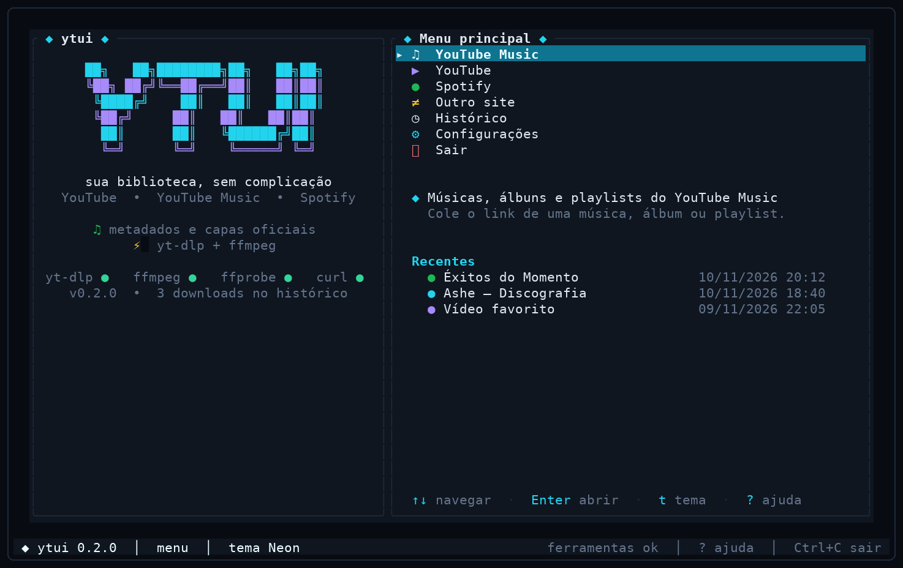
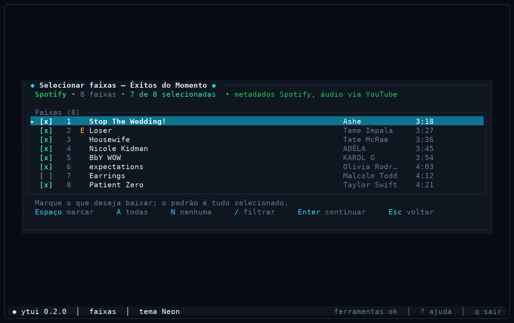

# ytui

Interface de terminal em português para baixar e organizar músicas e vídeos do
**YouTube**, **YouTube Music** e **Spotify** — com metadados, capas, playlists,
listas M3U e uma experiência pensada para teclado.



## Destaques

- **YouTube Music, YouTube e Spotify** em um só lugar, com detecção automática
  do link colado.
- **Spotify sem login e sem chave de API**: links públicos de música, álbum,
  playlist e artista são resolvidos pela página pública de embed. O Spotify
  fornece título, artistas, capa, duração e ordem; o áudio é baixado da melhor
  correspondência no YouTube.
- **Correspondência inteligente**: busca no YouTube, compara título, artista,
  canal e duração e penaliza karaokê, cover, remix, tradução, lyric video e
  versões aceleradas. A confiança aparece no registro.
- **Seleção de faixas** antes de baixar, com filtro por título/artista e atalhos
  para todas, nenhuma ou inverter.


- **Tags e capas do Spotify** aplicadas com ffmpeg (ID3/MP4/FLAC), além de
  `capa.jpg` por álbum/playlist.
- **Organização automática** em `Músicas/Artista/Álbum (ano)`, `Vídeos/Ano` e
  `Músicas/Spotify/Playlist`.
- **Listas M3U** para playlists e álbuns.
- **Tema premium**: cinco paletas (Neon, Nord, Dracula, Solarized, Mono),
  dashboard com histórico recente, animações, toasts e ajuda contextual.
- **Interface resiliente**: restaura o terminal em panics, suporta bracketed
  paste, scroll no registro, cancelamento que mata o yt-dlp e não deixa
  processos órfãos.
- **CLI completa** (`ytui-dl`) com as mesmas capacidades, seleção, saída JSON e
  integração para automação.
- **Diagnóstico** de yt-dlp/ffmpeg/ffprobe/curl, atualização do yt-dlp e
  configuração atômica.

## Requisitos

| Ferramenta | Para quê | Obrigatória |
| --- | --- | --- |
| [Rust](https://rustup.rs/) 1.75+ | compilar | sim |
| [yt-dlp](https://github.com/yt-dlp/yt-dlp) | baixar e pesquisar | sim |
| [ffmpeg](https://ffmpeg.org/) + `ffprobe` | converter, embutir tags/capas | sim |
| `curl` | resolver Spotify e baixar capas | sim para Spotify |
| `notify-send` | notificações no Linux | opcional |
| `xdg-open` / `open` | abrir a pasta ao concluir | opcional |
| `wl-paste`, `xclip` ou `xsel` | colar com Ctrl+V no Linux | opcional |

No Fedora:

```bash
sudo dnf install yt-dlp ffmpeg curl libnotify xdg-utils
```

No Ubuntu/Debian:

```bash
sudo apt install yt-dlp ffmpeg curl libnotify-bin xdg-utils
```

> Mantenha o yt-dlp atualizado. A tela **Configurações → Atualizar yt-dlp**
> tenta `yt-dlp -U` e, se necessário, `pip install --user -U yt-dlp`.

## Instalação

```bash
git clone <este-repositório> ytui
cd ytui
cargo build --release
install -Dm755 target/release/ytui     ~/.local/bin/ytui
install -Dm755 target/release/ytui-dl  ~/.local/bin/ytui-dl
```

Garanta que `~/.local/bin` está no `PATH`. Também funciona com:

```bash
cargo install --path .
```

## Uso

```bash
ytui       # interface
ytui-dl --help
```

### Interface

1. Escolha a fonte no menu: YouTube Music, YouTube, Spotify ou outro site.
2. Cole o link (Ctrl+V) e pressione Enter.
3. Em playlists, selecione as faixas e pressione Enter.
4. Ajuste formato, qualidade, capa, metadados, organização e M3U.
5. Acompanhe o progresso; Esc cancela.
6. Ao concluir, **O** abre a pasta e **N** inicia outro download.

O tipo do link é detectado automaticamente: um link do Spotify funciona mesmo
que você esteja no menu do YouTube, e vice-versa.

### Spotify

- Funciona com links públicos de **música**, **álbum**, **playlist** e
  **artista**.
- Também aceita URIs `spotify:track:...`, links `intl-pt`, `embed` e links
  curtos (`spotify.link`).
- **Não é necessário login.** O ytui lê os metadados públicos da página de
  embed do Spotify.
- O áudio **não** é extraído do Spotify (que usa DRM). O ytui pesquisa a faixa
  no YouTube e baixa a correspondência de maior pontuação.
- Playlists privadas, podcasts e episódios não são suportados.
- A confiança da correspondência aparece no registro (`✓` para confiável,
  `⚠` para baixa confiança). Você pode revisar o arquivo depois.

> Use apenas conteúdo que você tem direito de baixar e respeite os termos de
> serviço das plataformas.

### CLI

```bash
# Spotify: playlist, apenas as 10 primeiras, em FLAC, com M3U
ytui-dl --url "https://open.spotify.com/playlist/..." \
        --select 1-10 --format flac --m3u

# Listar faixas sem baixar
ytui-dl --url "https://open.spotify.com/album/..." --list

# YouTube: vídeo em 1080p
ytui-dl "https://youtu.be/..." --kind video --resolution 1080

# Automação: JSON silencioso
ytui-dl --url "https://open.spotify.com/track/..." --json

# Playlist do YouTube com cookies do navegador
ytui-dl "https://www.youtube.com/playlist?list=..." \
        --cookies firefox --select 3,5-8 --no-thumbnail
```

Opções principais:

| Opção | Descrição |
| --- | --- |
| `--kind musica\|video\|spotify\|outro` | força o tipo (o Spotify é detectado pela URL) |
| `--format mp3\|flac\|opus\|m4a\|wav\|original` | formato de áudio |
| `--video-format mp4\|webm\|mkv\|original` | contêiner de vídeo |
| `--quality maxima\|alta\|media\|baixa` | qualidade do áudio |
| `--resolution melhor\|2160\|...\|360\|audio` | resolução do vídeo |
| `--base DIR` | pasta base |
| `--select 1,3-5` | seleciona faixas (1-based) |
| `--playlist-end N` | limita às N primeiras |
| `--m3u` / `--no-m3u` | gera lista M3U |
| `--cookies NAVEGADOR` | cookies logados (`firefox`, `chrome`, ...) |
| `--limit-rate 4M` | limita a velocidade |
| `--workers N` | buscas Spotify em paralelo (1–8) |
| `--archive` | não baixa de novo itens no arquivo do yt-dlp |
| `--list` | lista as faixas e sai |
| `--json` | saída JSON silenciosa |
| `--no-convert`, `--no-thumbnail`, `--no-metadata`, `--no-organize`, `--no-number` | desliga etapas |
| `--sponsorblock` | remove patrocínios de vídeos |

`ytui-dl` retorna código 0 quando pelo menos um arquivo é organizado (ou quando
tudo já está no arquivo) e código 1 em falha.

## Configuração

Arquivo: `~/.config/ytui/config.json` (ou `$XDG_CONFIG_HOME/ytui/config.json`).
A gravação é atômica; um JSON inválido é preservado como `config.json.invalid` e
os padrões são restaurados.

```json
{
  "version": 2,
  "base_dir": "/home/você/Mídia",
  "default_audio_format": "mp3",
  "default_audio_quality": "maxima",
  "default_video_container": "mp4",
  "default_video_quality": "melhor",
  "proxy": "",
  "sleep_requests": 0,
  "sponsorblock": false,
  "theme": "neon",
  "notifications": true,
  "write_m3u": false,
  "cookies_from_browser": "",
  "limit_rate": "",
  "spotify_workers": 3,
  "download_archive": false,
  "open_folder_after": false,
  "history": []
}
```

Temas: `neon`, `nord`, `dracula`, `solarized`, `mono`.

Arquivo de histórico do yt-dlp: `~/.local/share/ytui/archive.txt` (XDG).

## Organização

```
Mídia/
├── Músicas/
│   ├── Artista/
│   │   └── Álbum (2024)/
│   │       ├── 01 - Faixa.mp3
│   │       └── capa.jpg
│   └── Spotify/
│       └── Nome da Playlist/
│           ├── 01 - Artista - Faixa.mp3
│           ├── 02 - Outro Artista - Outra Faixa.mp3
│           └── Nome da Playlist.m3u8
├── Vídeos/
│   └── 2024/
│       └── Título.mp4
└── Outros/
    └── 2024/
```

- Capas vêm do Spotify quando a fonte é Spotify e do thumbnail do vídeo nos
  demais casos.
- Tags do Spotify: título, artista, álbum (quando disponível), ano, faixa,
  disco e comentário. MP3, M4A, MP4 e FLAC recebem capa embutida; Opus/WAV
  recebem as tags e uma `capa.jpg` separada.
- Faixas isoladas não são numeradas; playlists e álbuns são.

## Atalhos

| Tecla | Ação |
| --- | --- |
| `↑` `↓` | navegar |
| `Enter` | confirmar / abrir |
| `Esc` | voltar / cancelar |
| `?` / `F1` | ajuda |
| `T` | alternar tema (no menu) |
| `Q` / `Ctrl+C` | sair |
| `Espaço` | marcar/desmarcar faixa |
| `A` / `N` / `I` | todas / nenhuma / inverter |
| `/` | filtrar faixas |
| `PgUp` / `PgDn` | rolar listas e registro |
| `S` | iniciar download (na tela de opções) |
| `O` | abrir pasta (resultado/histórico) |
| `N` | novo download (resultado) |

## Solução de problemas

**“yt-dlp falhou” / vídeo não baixa.** Atualize o yt-dlp. Vídeos com restrição de
idade podem exigir `--cookies firefox` (ou outro navegador logado).

**Spotify não resolve.** O link precisa ser público. Playlists privadas e
podcasts não são suportados. Verifique a conexão e se o `curl` está instalado.

**A faixa baixada não é a versão certa.** A correspondência usa título/artista/
duração e marca baixa confiança com `⚠`; você pode baixar novamente com outra
fonte ou editar as tags. Faixas ao vivo, remixes e versões regionais são os
casos mais difíceis.

**Capa não embutida.** Alguns formatos (Opus/WAV) não aceitam capa via ffmpeg;
a imagem é salva como `capa.jpg` ao lado do áudio.

**Terminal quebrado após um erro.** O ytui restaura o terminal no `Drop` e em
panics. Se algo externo matar o processo, use `reset`.

**Terminal muito pequeno.** A interface exige pelo menos 60x16.

## Desenvolvimento

```bash
cargo fmt --all
cargo clippy --all-targets -- -D warnings
cargo test
cargo build --release
```

Testes: unidade para parsing de URLs do Spotify, embed, pontuação de
correspondência, configuração, tags, organização, progresso do yt-dlp; e smoke
tests de todas as telas com `ratatui::backend::TestBackend`.

Arquitetura:

| Módulo | Responsabilidade |
| --- | --- |
| `src/spotify.rs` | parsing de links, embed público, modelos Spotify |
| `src/matching.rs` | busca no YouTube e pontuação de correspondência |
| `src/media.rs` | detecção de fonte e conversão para o modelo comum |
| `src/backend.rs` | argumentos do yt-dlp, progresso, cancelamento, lote |
| `src/pipeline.rs` | orquestração Spotify (match → download → tags) |
| `src/organize.rs` | destino, tags ffmpeg, capas, M3U, limpeza |
| `src/app.rs` / `src/ui.rs` | estado da TUI e telas |
| `src/bin/ytui-dl.rs` | interface de linha de comando |

Licença: MIT.
